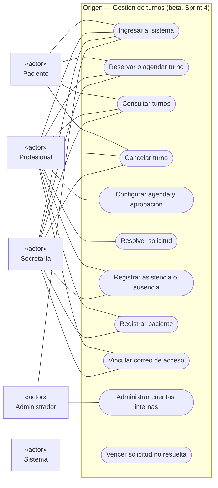
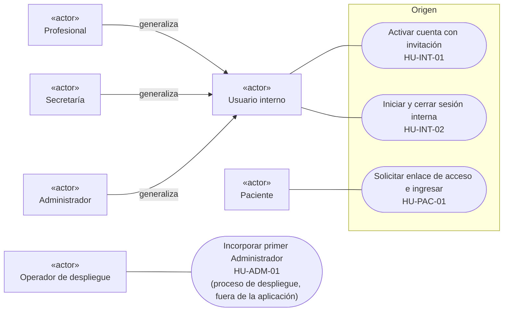
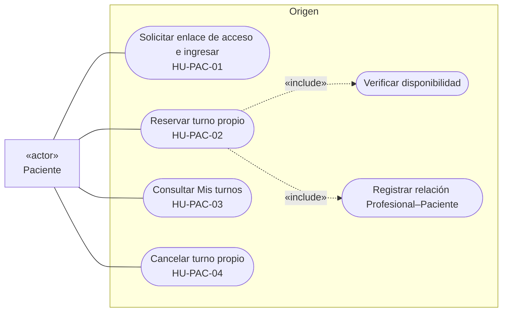
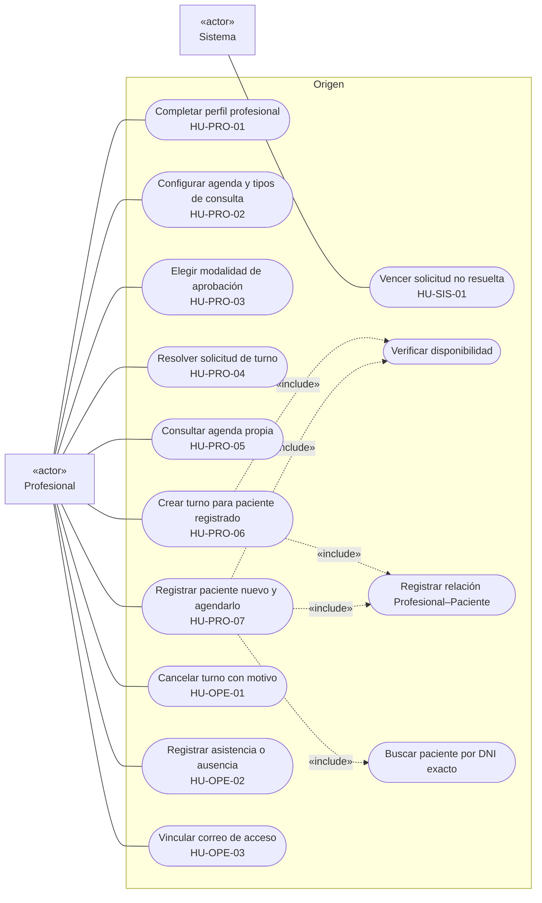
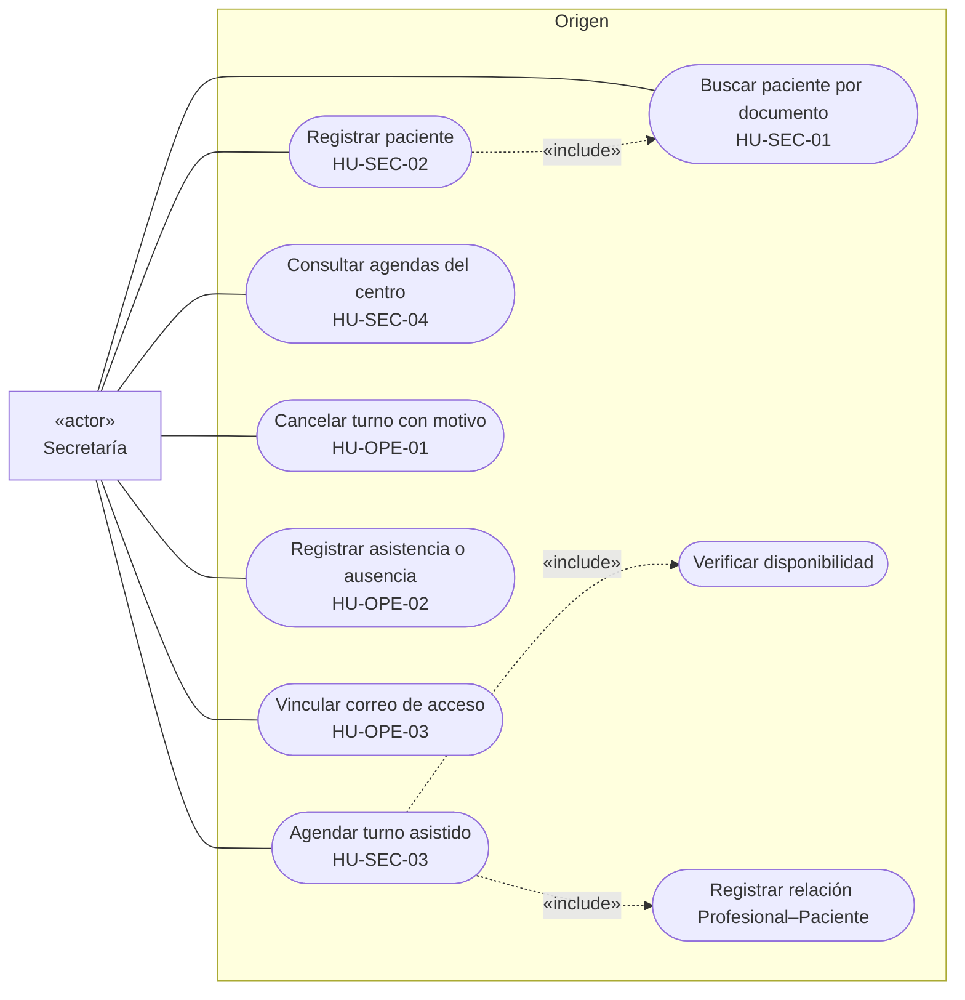
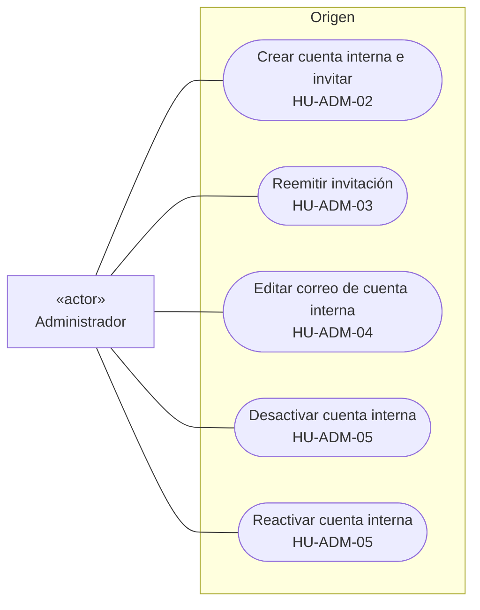

# Diagramas de casos de uso — Sprint 4

Corte: `develop` @ `0c38d8a` (2026-11-11). Representan el mismo alcance que las [historias de usuario](./historias-de-usuario.md).

## 1. Criterio de selección y organización

**Qué se incluye**

- Solo capacidades **implementadas** al corte (secciones 1 a 5 de las historias). Lo pendiente, las maquetas con datos ficticios (pagos, resumen económico) y lo excluido de la beta no se dibujan.
- Cada caso de uso es un objetivo del actor frente al sistema («Reservar turno», «Resolver solicitud»), no una pantalla, botón ni ruta. Por eso, por ejemplo, configurar intervalo, tipos de consulta, disponibilidad, anticipación y horizonte se agrupan en un único caso «Configurar agenda».
- Se usan `«include»` solo cuando un paso es obligatorio y se repite en varios casos (verificar disponibilidad, registrar la relación Profesional–Paciente, buscar paciente por documento). No se usan `«extend»`: las variantes se describen en los criterios de aceptación.
- Las reglas de permisos (denegación por defecto, privacidad, estados) no se dibujan como casos; están en las reglas transversales de las historias.

**Actores**

| Actor | Tipo | Motivo de inclusión |
| --- | --- | --- |
| Paciente | Rol de aplicación | Reserva, consulta y cancela sus turnos. |
| Profesional | Rol de aplicación (usuario interno) | Configura y opera su agenda. |
| Secretaría | Rol de aplicación (usuario interno) | Registra pacientes y opera todas las agendas. |
| Administrador | Rol de aplicación (usuario interno) | Administra las cuentas del personal. |
| Usuario interno | Actor abstracto | Generaliza a Profesional, Secretaría y Administrador para activar cuenta e iniciar sesión. |
| Operador de despliegue | Actor externo | Único actor del alta del primer Administrador (fuera de la aplicación). |
| Sistema (temporizador) | Actor secundario | Vence solicitudes no resueltas. |

**Organización**

Se eligió una combinación: un **diagrama general** con los casos principales de cada actor para la visión de conjunto, y **un diagrama por rol** con el detalle legible. Un único diagrama con los 26 casos y sus relaciones resultaba ilegible; diagramas solo por funcionalidad repetían actores sin mostrar qué puede hacer cada rol, que es lo que pide la entrega.

**Notación**

Mermaid no tiene un tipo de diagrama de casos de uso, por lo que se usa un diagrama de flujo con convenciones UML: actores como nodos con «actor», casos de uso como elipses, el rectángulo del sistema como `subgraph`, asociaciones con líneas continuas e `«include»` con flechas punteadas. Los identificadores `HU-…` permiten trazar cada caso a su historia.

## 2. Diagrama general

## 3. Acceso al sistema

## 4. Paciente

## 5. Profesional

## 6. Secretaría

## 7. Administrador

El Administrador no tiene casos de uso sobre pacientes, agendas, turnos ni datos económicos (denegación por defecto, contrato #372).

## 8. Trazabilidad entre diagramas e historias

| Caso del diagrama general | Historias | Actores |
| --- | --- | --- |
| Ingresar al sistema | HU-INT-01, HU-INT-02, HU-PAC-01 (y HU-ADM-01 fuera de la aplicación) | Todos |
| Reservar o agendar turno | HU-PAC-02, HU-PRO-06, HU-PRO-07, HU-SEC-03 | Paciente, Profesional, Secretaría |
| Consultar turnos | HU-PAC-03, HU-PRO-05, HU-SEC-04 | Paciente, Profesional, Secretaría |
| Cancelar turno | HU-PAC-04, HU-OPE-01 | Paciente, Profesional, Secretaría |
| Configurar agenda y aprobación | HU-PRO-01, HU-PRO-02, HU-PRO-03 | Profesional |
| Resolver solicitud | HU-PRO-04 | Profesional |
| Registrar asistencia o ausencia | HU-OPE-02 | Profesional, Secretaría |
| Registrar paciente | HU-SEC-01, HU-SEC-02, HU-PRO-07 | Secretaría, Profesional |
| Vincular correo de acceso | HU-OPE-03 | Profesional, Secretaría |
| Administrar cuentas internas | HU-ADM-02 a HU-ADM-05 | Administrador |
| Vencer solicitud no resuelta | HU-SIS-01 | Sistema |
