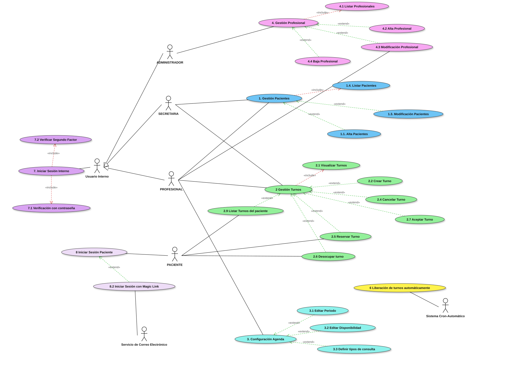

# Diagrama de casos de uso

El diagrama organiza los casos de uso por módulo: cada módulo tiene un caso de uso «Gestión», del que extienden sus operaciones. La numeración de los casos coincide con la de las [historias de usuario](./historias-de-usuario.md).

Cada caso de uso representa un objetivo del actor frente al sistema. Los «include» indican pasos obligatorios (listar, visualizar, verificar contraseña y segundo factor) y los «extend» las operaciones de cada módulo. Usuario Interno generaliza a Administrador, Secretaria y Profesional. El Sistema Cron-Automático marca como vencidas las solicitudes no resueltas (caso 6) y el Servicio de Correo Electrónico entrega los enlaces de acceso de los pacientes.

| Módulo | Casos de uso | Actores |
| --- | --- | --- |
| 1. Gestión Pacientes | 1.1 Alta, 1.3 Modificación, 1.4 Listar | Secretaria, Profesional |
| 2 Gestión Turnos | 2.1 Visualizar, 2.2 Crear, 2.4 Cancelar, 2.5 Reservar, 2.6 Desocupar, 2.7 Aceptar, 2.9 Listar turnos del paciente | Secretaria, Profesional, Paciente |
| 3. Configuración Agenda | 3.1 Editar periodo, 3.2 Editar disponibilidad, 3.3 Definir tipos de consulta | Profesional |
| 4. Gestión Profesional | 4.1 Listar, 4.2 Alta, 4.3 Modificación, 4.4 Baja | Administrador, Profesional (4.3) |
| 6 Liberación de turnos automáticamente | 6 | Sistema Cron-Automático |
| 7. Iniciar Sesión Interno | 7.1 Verificación con contraseña, 7.2 Verificar segundo factor | Usuario Interno |
| 8 Iniciar Sesión Paciente | 8.2 Iniciar sesión con Magic Link | Paciente, Servicio de Correo Electrónico |
