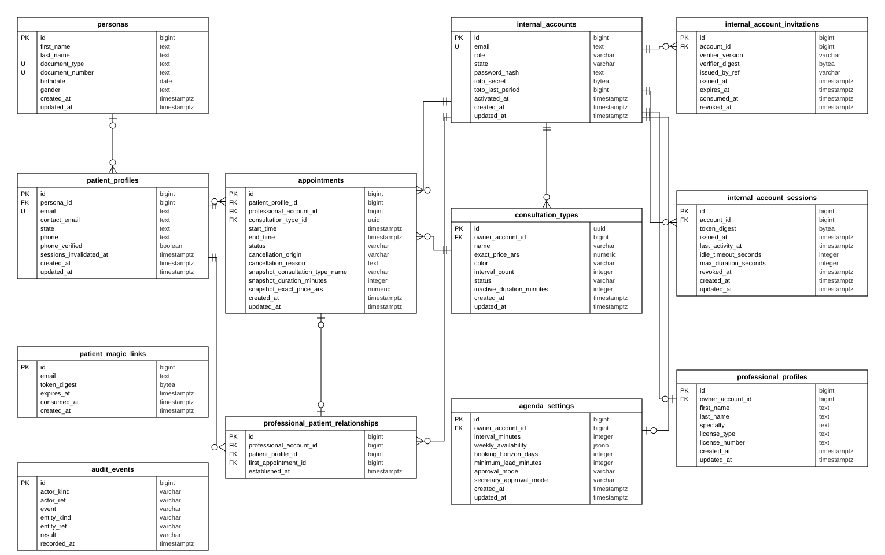

# Diagrama entidad-relación

El modelo de datos separa la identidad de la persona (`personas`) de su perfil de paciente (`patient_profiles`) y de las cuentas del personal (`internal_accounts`), que agrupan a administradores, profesionales y secretarias según su rol. Cada turno (`appointments`) vincula un paciente, un profesional y un tipo de consulta, y conserva una copia del nombre, la duración y el precio del tipo al momento de reservar. La relación profesional–paciente se registra al reservar el primer turno. Las configuraciones del profesional se guardan en `professional_profiles`, `agenda_settings` y `consultation_types`; las invitaciones, sesiones y enlaces de acceso, en sus tablas propias, y todas las operaciones sensibles quedan registradas en `audit_events`.

| Tabla | Contenido |
| --- | --- |
| `personas` | Identidad de la persona: nombre, apellido, documento y fecha de nacimiento. |
| `patient_profiles` | Perfil de paciente: correo de acceso, correo de contacto, teléfono y estado. |
| `patient_magic_links` | Enlaces de acceso de un solo uso enviados al correo del paciente. |
| `internal_accounts` | Cuentas de Administrador, Profesional y Secretaria, con contraseña y TOTP. |
| `internal_account_invitations` | Invitaciones de activación de las cuentas internas. |
| `internal_account_sessions` | Sesiones activas de las cuentas internas. |
| `professional_profiles` | Perfil del profesional: nombre, especialidad y matrícula. |
| `agenda_settings` | Intervalo de agenda, disponibilidad semanal, anticipación, horizonte y modalidad de aprobación. |
| `consultation_types` | Tipos de consulta de cada profesional: nombre, precio, color y duración. |
| `appointments` | Turnos, con su estado, la cancelación y la copia de los datos del tipo de consulta. |
| `professional_patient_relationships` | Relación entre un profesional y un paciente, creada con el primer turno. |
| `audit_events` | Registro de auditoría de solo agregado. |
